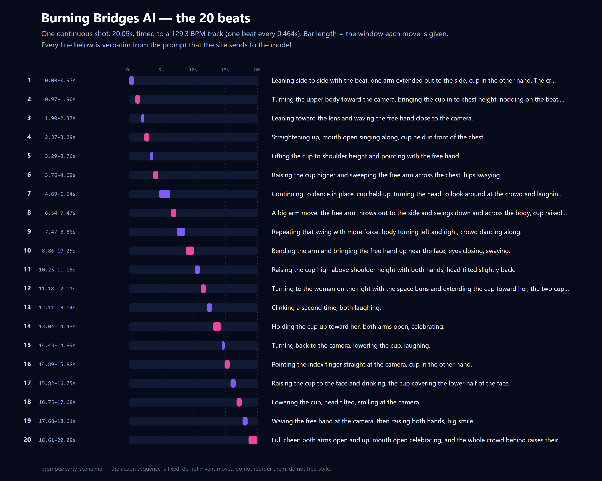
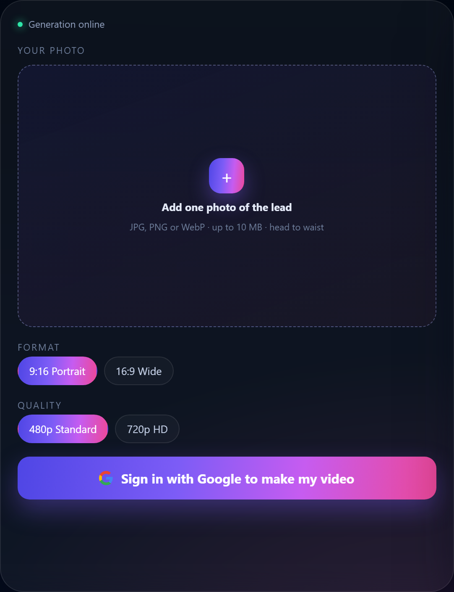

# Burning Bridges AI — the party-scene prompt

The prompt behind [Burning Bridges AI](https://burningbridgesai.info): **one photo
in, a 20-second party-scene clip out** (9:16 or 16:9). Published here in full so
you can run it yourself — on ByteDance Seedance 2.5 through
[kie.ai](https://kie.ai), or on whatever model you already use.



That figure is not an illustration: it is generated from the prompt's own action
list. Twenty beats, one continuous shot, every move given its own time window on a
129.3 BPM track — one beat every 0.464 seconds.



## What is in here

| Path | What it is |
| --- | --- |
| [`prompts/party-scene.md`](prompts/party-scene.md) | The prompt, verbatim — 5,780 characters, exactly what the site sends |
| [`prompts/party-scene-short.md`](prompts/party-scene-short.md) | A condensed version, for lists and READMEs that cap entry length |
| [`examples/beat-map.svg`](examples/beat-map.svg) | The 20 beats as a timeline, generated from the prompt |
| [`docs/audio-findings.md`](docs/audio-findings.md) | What I measured about the vendor and audio — it is why the track is attached after the render |

## Three real use cases

### 1. One photo of a person

The reference photo is the identity source: the same face, hair and (if they are
visible in the photo) the same clothes, in every frame. The subject stands centre
frame at chest height, holding a cup, and the room is built around them — dark
wood panels, a crystal chandelier, a bar table with green under-lighting, a crowd
of about twenty dancing behind.

Watch out for: the crowd. "A crowd of twenty" is enough for the model to invent
faces in the background; the prompt keeps the lead centred and the depth of field
shallow so they stay texture rather than characters.

### 2. Vertical or widescreen — one line changes

Nine-sixteen for TikTok, Reels and Shorts; sixteen-nine for everything else. That
is the only difference: one sentence in the `OUTPUT` block. The shot is composed
so it survives both, because the lead never leaves the centre of the frame.

### 3. A different track, or a shorter clip

The beats are timings, not a paragraph of vibes: beat 12 lands at 11.18s and beat
20 closes at 20.09s. If your track is a different tempo or you want 15 seconds,
**rescale the windows** (multiply every time by your length ÷ 20.09) rather than
deleting beats — the sequence is a story with a turn in the middle (the cup clink
at 11.18s) and the finish has to land on the last bar of the music.

## Why the prompt is written the way it is

1. **Twenty beats with explicit windows.** Every gesture names its own seconds, so
   the model places moves instead of improvising a dance nobody asked for.
2. **"MUST MATCH THE REFERENCE EXACTLY — do not invent, skip, reorder or
   free-style."** The trend is a specific choreography; a free-styled clip is a
   different video, and that difference is exactly what viewers notice.
3. **IDENTITY LOCK, stated as the most important rule.** Face, hairstyle, hair
   length, colour and hairline pinned to the photo for every frame. Most drift in
   one-photo video is the model quietly redesigning the person.
4. **One continuous handheld take, no cuts.** The trend is a single 20-second shot
   at chest height with a slight orbit — cuts would make it read as a montage.
5. **The scene is fixed, and it is fixed for a reason.** The camera move at 11.18s
   clinks cups with "the woman on the right with the space buns", so she has to
   exist in the room from the first frame. Scene and action are one decision.
6. **The CLOTHING rule.** Whatever is visible in the photo stays; if nothing is
   visible, the model dresses the subject in plain party clothes — and keeps it
   consistent, which is the part it gets wrong if you leave it unstated.
7. **An absolute content rule, placed above everything else.** The prompt is
   explicit that the subject is fully and modestly dressed in every frame and that
   this rule overrides the rest.
8. **The AUDIO rule, in words.** The supplied track is the only sound: no invented
   music, no crowd noise, no speech. The vendor's own audio generation is switched
   off in the request as well, so the instruction and the setting agree.
9. **The track is attached after the render, not asked for from the vendor.** That
   is a measured decision, not a preference — see
   [`docs/audio-findings.md`](docs/audio-findings.md).
10. **No on-screen text, captions or watermarks.** The clip has to be postable as
    it downloads.

## How to run it

1. **Send the photo as a reference image** (`reference_image_urls`) — one image,
   not a first frame. The prompt treats it as the identity source.
2. **Send ratio, resolution, duration and format as request fields**, not as prose.
   On kie.ai the body looks like this (prompt truncated here):

   ```json
   {
     "model": "bytedance/seedance-2-5",
     "input": {
       "prompt": "CAMERA\nLive-action photorealistic party video, 30fps, one single continuous handheld take...",
       "reference_image_urls": ["<your photo>"],
       "resolution": "480p",
       "aspect_ratio": "9:16",
       "duration": 20,
       "output_format": "mp4",
       "generate_audio": false,
       "nsfw_checker": true
     }
   }
   ```

3. **Twenty seconds needs the 2.5 tier.** Seedance 2.5 accepts 4–30 seconds;
   Seedance 2.0 and its Fast and Mini tiers cap at 15. If you want the full
   sequence, 2.5 is the tier that will take it.
4. **Bring your own track.** The prompt expects a supplied soundtrack at 129.3 BPM
   and tells the model to use nothing else. The music is *not* in this repo — use
   something you have the right to publish, and attach it to the finished file
   yourself (see the audio notes).
5. **Leave the vendor's moderation flag on.** It costs nothing and it is the first
   of two checks before a clip is delivered.

## What to expect, and what not to

- **Shape**: 20 seconds, one continuous shot, 9:16 or 16:9, no captions, no
  watermark.
- **Cost per clip at list price** (Seedance 2.5, 20 seconds, no reference video):
  about **$2.80 at 480p** and **$6.30 at 720p**. That is the largest cost in this
  product, and the reason the hosted version sells credit packs rather than a
  subscription.
- **It is not deterministic.** Faces and the background crowd drift occasionally.
  The identity lock and the fixed scene reduce it; they do not remove it.
- **The people in the background are invented.** That is normal for this trend and
  it is also why the lead stays centred and close.
- **Photos must be yours** — or of an adult who agreed to appear. No celebrities,
  no minors, no strangers.
- **It is a stylised fictional scene**, not footage of a real party.

## The hosted version

If you would rather not wire a model up yourself:
[**burningbridgesai.info**](https://burningbridgesai.info) runs exactly this prompt
behind a one-photo upload, with 480p or 720p and 9:16 or 16:9. One-time credit
packs start at **$6.90 for 2 credits**, which is one 480p video; $13.90 buys 5
credits and $35.90 buys 15. No subscription, credits do not expire, and a render
that fails is refunded automatically.

## License

MIT for everything in this repository — the prompt, the figures, the notes. Use it,
adapt it, ship it commercially. A link back to
[burningbridgesai.info](https://burningbridgesai.info) is appreciated, not required.

The soundtrack is not covered by this licence and is not included: it belongs to
whoever made it.
